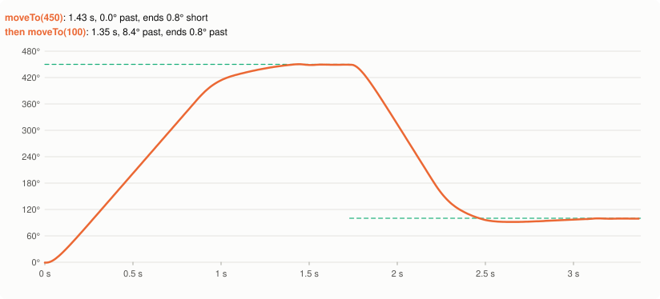
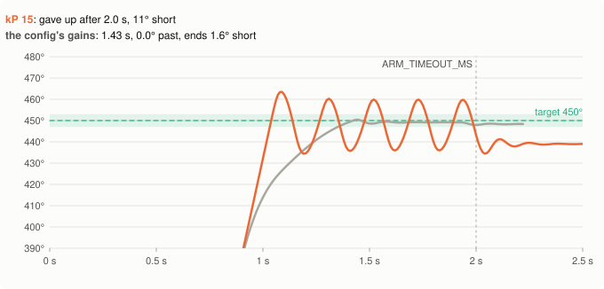
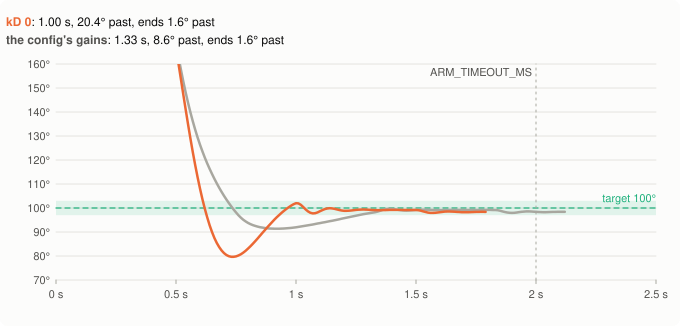
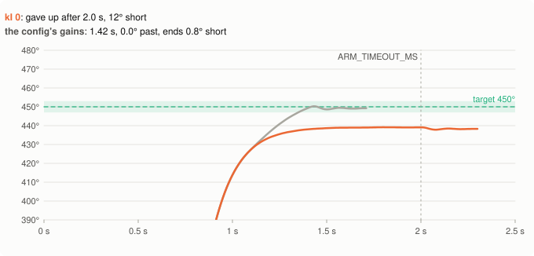
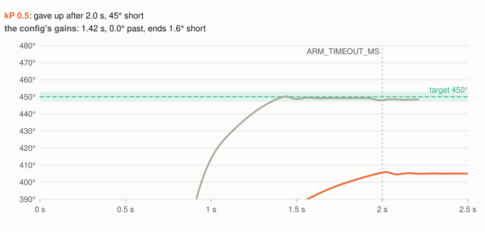
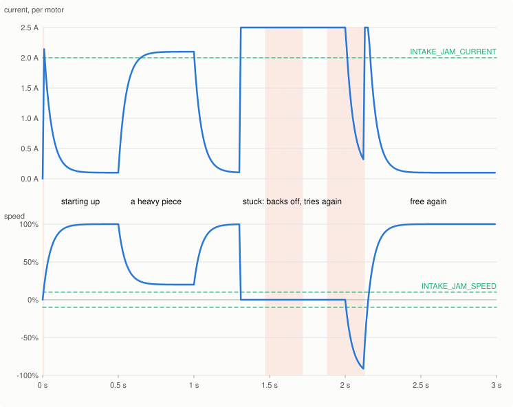

# Arms and intakes

Besides the drivetrain, most robots have an arm (or a lift) that moves to a few positions and has
to stay there, and an intake that pulls game pieces in. The library has one class for each:

- An **`Arm`** moves to a position with a PID (`moveTo`), and then the motor's own controller takes
  it the last bit and holds it there, even with something heavy on it. In driver control a joystick moves it, and letting go
  holds it.
- An **`Intake`** spins, and notices when a game piece gets stuck: the motor draws a lot of current
  but hardly turns. Then it runs backwards for a moment to free the piece, and forward again.

Both run in the background: `arm.moveTo(450)` and `intake.spin(100)` return at once, and the robot
can drive meanwhile. This page shows how to set them up, how to tune an arm, and how to set up the
jam check. [How it works, section 11](how-it-works.md#11-mechanisms-an-arm-that-holds-an-intake-that-unjams)
explains the code inside, and `examples/mechanisms` is a whole program with both.

The pictures come from the simulator ([Making the pictures](#making-the-pictures)). The arm pictures
use the *realistic* simulator, which reads the motors 10 ms late, like a real robot. That delay is
what makes an arm swing; the perfect simulator forgives a lot more (the tables show both).

- [1. Setting them up](#1-setting-them-up)
- [2. Using them in autonomous and driver control](#2-using-them-in-autonomous-and-driver-control)
- [3. What a good arm move looks like](#3-what-a-good-arm-move-looks-like)
- [4. Tuning the arm](#4-tuning-the-arm)
- [5. Holding](#5-holding)
- [6. The intake: noticing a jam](#6-the-intake-noticing-a-jam)
- [7. What you see, what to change](#7-what-you-see-what-to-change)

---

## 1. Setting them up

Make them outside any function, next to the motors they use, so they exist for the whole program:

```cpp
motor armMotor(PORT9, ratio36_1, false);
Arm arm(armMotor);

motor intakeMotor(PORT11, ratio6_1, false);
Intake intake(intakeMotor);
```

Two motors that always move together (a lift with a motor on each side) go into a `motor_group`,
and the group into one `Arm` or `Intake`:

```cpp
motor liftLeft(PORT9, ratio36_1, false);
motor liftRight(PORT10, ratio36_1, true);   // mirrored, so it turns the other way
motor_group liftMotors(liftLeft, liftRight);
Arm lift(liftMotors);
```

You can have up to 8 Arms and 8 Intakes. Set each motor's `reversed` flag (the `true`/`false`) so
that positive power moves the arm **up** and the intake **in**: everything below counts on that.

**Positions are degrees of the motor**, not of the arm. With a 36:1 cartridge and an arm geared
5:1 after the motor, the motor turns 5 times as far as the arm: 450 motor degrees is 90 arm
degrees. You don't need to work that out. Find your positions like this:

1. At the start, with the arm resting all the way down, call `arm.resetPosition(0)` (in
   `pre_auton`, or at the start of `main`). From then on, down is 0.
2. Show `arm.position()` on the Brain screen (`examples/mechanisms` does it in driver control), move
   the arm with the stick (or by hand, with the robot disabled) to each position you need, and
   write the numbers down.
3. Put them in your code as constants, for example `const double ARM_SCORE = 450;`.

Then `arm.setLimits(0, 600)` (after `resetPosition`) keeps both `moveTo` and the stick between the
lowest and highest position: a `moveTo(700)` goes to 600, and the stick stops there.

Each Arm uses the gains in `simpleV5LibConfig.h` (`ARM_KP`, `ARM_KI`, `ARM_KD`), unless you give it
its own: `Arm arm(armMotor, 1.5, 0.05, 20);`. A light claw and a heavy lift usually need different
ones.

## 2. Using them in autonomous and driver control

In autonomous, a command starts the mechanism and returns at once:

```cpp
intake.spin(100);              // runs in the background
PID_forward(24, 0.3, 0.2);     // drive while the intake runs
arm.moveTo(ARM_SCORE);         // starts raising the arm...
PID_turn(90, 0.5, 0.2);        // ...while the robot turns
if (arm.waitUntilDone()) {     // up before scoring: false if it didn't get there
    intake.spin(-100);         // push the game piece out
    wait(500, msec);
}
intake.stop();
arm.moveTo(ARM_DOWN);          // lower it again, no need to wait
```

- `arm.waitUntilDone()` waits for the arm, and returns false if it didn't get there within
  `ARM_TIMEOUT_MS` (2 seconds): stuck on something. Then it holds wherever it got to.
  `arm.isDone()` asks without waiting.
- `intake.spin(100, false)` turns the unjamming off: when the motor can't turn any more, the intake
  stops and `intake.isJammed()` stays true. That is also what happens when a game piece is all the
  way in, so it is a way to know it is ([section 6](#6-the-intake-noticing-a-jam)).

In driver control, call the commands every time through the loop:

```cpp
if (Controller.ButtonL1.pressing()) {
    arm.moveTo(ARM_SCORE);       // the same moveTo every 20 ms is fine: a repeat is ignored
}
arm.manual(Controller.Axis2.position(percentUnits::pct)); // the stick; 0 = hold right here

if (Controller.ButtonR1.pressing()) {
    intake.spin(100);
} else if (Controller.ButtonR2.pressing()) {
    intake.spin(-100);
} else {
    intake.stop();
}
```

- A command that is the same as the last one is ignored, so holding a button doesn't restart the
  move 50 times a second. The one exception: a `moveTo` that gave up tries again.
- `arm.manual(power)` drives the arm with the stick. Let go (0, or anything inside `DRIVE_DEADBAND`)
  and it holds right where it is. A stick at rest doesn't stop a running `moveTo`: pressing L1 and
  letting go of the button still gets the arm up.
- Near a limit (`setLimits`), the stick's power is eased off, so the arm doesn't fly past the limit;
  at the limit it holds for as long as you push that way.
- A mechanism keeps doing its last command until it gets a new one. So give each one a command at
  the start of `usercontrol()` (`intake.stop()`), or autonomous's last `intake.spin(100)` keeps
  going ([Writing autonomous](writing-autonomous.md) has the whole `usercontrol()`).
- `arm.release()` stops holding and lets the arm hang loose.

## 3. What a good arm move looks like



This is an arm with the config's gains, heavy enough that gravity pulls it down with 15% of the
motor's power. Going up, it drives at nearly full power, slows down over the last 50 degrees or so
and gets there in under 1.5 seconds. Then the motor itself keeps it there ([section 5](#5-holding)).

Going down, gravity helps, and that is the harder way: near the target, the PID's push gets small,
and the arm's weight carries it about 8° past before the PID pushes it back up. For a heavy arm,
**test your moves both ways**: a gain that is fine going up can be too weak going down.

## 4. Tuning the arm

There is no graph for the arm, so let a small program tell you how each move went:

```cpp
double start = Brain.timer(msec);
arm.moveTo(ARM_SCORE);
bool there = arm.waitUntilDone();
printf("%.2f s, %s, at %.1f (target %.1f)\n", (Brain.timer(msec) - start) / 1000,
       there ? "there" : "GAVE UP", arm.position(), ARM_SCORE);
wait(1000, msec);
arm.moveTo(ARM_DOWN);      // and the same back down
```

Also watch it: the pictures below show what each mistake looks like. In each one, the gray line is
the config's gains doing the same move, the green band is `ARM_TOLERANCE` around the target
(inside it for `ARM_SETTLE_MS` counts as there), and the dotted line is `ARM_TIMEOUT_MS`.

Tune it like a turn ([Tuning the PID](tuning.md) explains the ideas): kP first, then kD, and kI
only for a heavy arm.

### kP too big: it swings



kP is how hard it pushes per degree it still has to go. Too small, and it gets there slowly; too
big, and it shoots past the target, turns around, shoots past the other way, ... With kP 15 the arm
never calms down enough to count as there, and after 2 seconds it gives up wherever it is. The
readings are a little late on a real robot, so the arm has already moved on when the PID reacts:
that's what makes it swing. On the perfect simulator (no delay) the same kP 15 gets there fine.

### kD: the brake, most of all going down



kD brakes by how fast the arm moves. Without it, the arm going down picks up speed, gravity
carries it 20° past, and it bounces back. More kD brakes earlier: with kD 20 the heavy arm goes
only 2 to 3° past going down. But a brake also slows down the move up: with kD 40 the move up takes
2 seconds, right at `ARM_TIMEOUT_MS`: it only just made it.

### kI: only for a heavy arm that stops short



P alone can't hold a heavy arm exactly at the target: near the target, P's push gets small, and it
stops where that push is as strong as gravity. That is `gravity / kP` degrees short: here 15% / 1.5
= 10° (a bit more on a drained battery), so with kI 0 it stops about 12° short, never gets inside
`ARM_TOLERANCE`, and gives up. kI adds up the error while the arm sits short of the target, and
pushes harder and harder until it gets there. A light arm (a claw) doesn't need it.

### ARM_INTEGRAL_RANGE: bigger than how far short it stops



kI only adds up the error once the arm is closer than `ARM_INTEGRAL_RANGE` (30°), so it can't
build up a huge push on the long way there. But that means it must be bigger than how far short P
alone stops. With kP 0.5 the arm stops 15% / 0.5 = 30° short or more (here 45°), never gets
within the range, and kI never starts. Fix it with a bigger kP (it stops less short), or a bigger
`ARM_INTEGRAL_RANGE`.

### The numbers

Each move started 10 times, 0 to 9 ms apart (ends: + = short of the target, - = past it):

| Gains (kP, kI, kD) | Up 0 → 450, realistic | Down 450 → 100, realistic | Up, perfect | Down, perfect |
| --- | --- | --- | --- | --- |
| The config's (1.5, 0.05, 10) | 1.42 to 1.43 s, ends 1.6 | 1.33 to 1.34 s, 8.4 to 8.6° past, ends -1.6 | 1.32 s, ends 1.5 | 0.75 s, 2.1 to 2.9° past, ends -1.5 |
| kP 15 | gave up (swings), 13.4 to 13.6° past | gave up (swings), 23.1 to 23.3° past | 1.12 s, 5.7 to 5.8° past, ends 1.5 | 0.71 s, 11.3 to 11.4° past, ends -1.5 |
| kD 0 | 1.19 s, ends 1.6 | 1.00 s, 20.4° past, ends -1.6 | 1.12 s, ends 1.5 | 0.97 s, 14.5° past, ends -1.5 |
| kD 20 | 1.60 to 1.61 s, ends 1.6 | 0.93 to 0.94 s, 2.3 to 3.0° past, ends -1.6 | 1.49 s, ends 1.5 | 0.90 s, 1.1 to 1.7° past, ends -1.5 |
| kD 40 | 1.99 s, ends 1.6 | 1.25 s, 0.9 to 1.7° past, ends -1.6 | 1.87 s, ends 1.5 | 1.22 s, 0.3 to 0.8° past, ends -1.5 |
| kI 0 | gave up, ends 11.6 to 11.9 | 0.80 s, 1.7 to 2.5° past, ends -1.6 | gave up, ends 10.8 | 0.77 s, 0.6 to 1.2° past, ends -1.5 |
| kP 0.5 | gave up, ends 44.8 to 45.1 | 1.90 to 1.92 s, 12.5 to 12.8° past, ends -1.6 | gave up, ends 40.5 | 1.86 s, 11.1° past, ends -1.5 |

(Every move starts held at its start position, also after gains that gave up on the way there.
The moves up hardly went past the target, except kP 15's. "ends" is where the arm was 0.8 s after
it finished, held by the motor: 1.5 to 1.6° below the target whenever it got there, which is how much the
simulated motor's hold sags under this arm, see [section 5](#5-holding).)

For this simulated arm, kD 20 would be a better choice than the config's 10: much less past the
target going down, for 0.2 s more going up. Your arm is different, so try it.

Things that don't help much:

- **A lower `max_speed`** (`arm.moveTo(100, 50)`) only limits the fast part in the middle. Going
  down, the arm goes past the target at the end, where the power is small anyway: with max_speed 50
  it still went 8.4 to 8.5° past on the realistic simulator and took 0.35 s longer; with 30, the
  push back up was too weak to get it back in time, and it gave up.
- **A bigger `ARM_TOLERANCE`** makes it count as there sooner, but also further from the target.

`ARM_TIMEOUT_MS` (2 seconds) only says when to give up. If your arm needs longer for a long move,
make it bigger; if it gives up on a short one, look for what blocks it first.

## 5. Holding

When the arm gets there (inside `ARM_TOLERANCE` for `ARM_SETTLE_MS`), the library hands it to the
motor in two steps:

1. `spinToPosition(target)`: the motor's own controller, inside the motor, takes it the last bit to
   the target.
2. Half a second later, hold mode where it is (`stop(hold)`): by then that is the target. The motor
   pushes back when something moves the arm away. That is what keeps a heavy arm up, and there is
   nothing to tune.

Why not simply stop it in hold mode where it is right away? The arm counts as there while it may
still be moving: a heavy arm going down is still falling at 50 to 80°/s when it gets inside the
tolerance. Held where it was at that moment, it ended up to 4.7° past the target on the simulator.
Taken to the target by the motor first, every move that got there ends within the hold's sag of it
(the table above).

And why not let the motor drive to the target for good? Because sometimes the arm can't get exactly
there, and the motor would push for the rest of the match:

- The arm rests on the frame at its lowest position, but reads a degree above the `resetPosition(0)`
  you gave it there (slack in the gears). Driving on to 0 pushes the arm into the frame.
- The two motors of a lift read a few degrees apart after a while. Each drives to the target by its
  own reading, so they push against each other through the lift.

Holding where it is pushes only when something moves the arm. The half second is `ARM_FINISH_MS` in
`src/mechanisms.cpp`.

The simulator's motor controller is a guess: it pushes back with 20% power per degree, so the 15%
arm sags about 0.75° below where it is held, and the table's arms end twice that below the target
(once below the target, then below where hold mode caught it). How a real V5 motor does it, nobody
has measured with this library yet: [First day on a real robot, step 11](first-robot-checklist.md#11-arm-and-intake)
checks it (push the held arm by hand, and move it back and forth a few times).

`resetPosition` after a `moveTo` also holds right where the arm is: within that half second the
motor may still be driving to the target, a number it would now count from the new zero.

The other ways the arm holds are hold mode where it is: `manual(0)` after the stick, reaching a
limit with the stick, and a `moveTo` that gave up (stuck on something: driving on to the target
would only push against what blocks it). `release()` lets go (coast): the arm falls if it is heavy.

## 6. The intake: noticing a jam



A motor that is told to spin but can't turn draws a lot of current. So the intake counts as jammed
when, for at least `INTAKE_JAM_MS` (150 ms), both:

- each motor draws more than `INTAKE_JAM_CURRENT` amps (2.0; a V5 motor draws at most 2.5), **and**
- it turns slower than `INTAKE_JAM_SPEED` percent of its top speed (10%).

The picture shows why it takes all three:

- **Starting up** (0 s): for a moment the motor draws a lot of current at low speed, like a jam.
  It is over before `INTAKE_JAM_MS`.
- **A heavy piece** (0.5 s): the current is over the limit for as long as the piece is in, but the
  intake still turns (at 20% here): not a jam.
- **Stuck** (1.3 s): the current goes to 2.5 A and the speed to 0. After `INTAKE_JAM_MS` it
  counts as a jam (170 ms here: the readings come every 10 ms), and the intake runs backwards for
  `INTAKE_UNJAM_MS` (250 ms, shaded), then forward again. Still stuck: it notices again and backs
  off again. Once the piece comes loose (2 s), it runs normally.

**Low power hides a jam.** The less power a stuck motor gets, the less current it draws. On the
simulator, a stuck intake draws:

| `intake.spin(...)` | Current, stuck | Noticed? |
| --- | --- | --- |
| 100 | 2.50 A | after 170 ms |
| 75 | 1.98 A | no |
| 50 | 1.35 A | no |
| 25 | 0.72 A | no |

These are the simulator's numbers (its motor is a simple model). Measure your own:

1. Show `intakeMotor.current(amp)` on the Brain screen.
2. Note it while the intake runs empty, while it pulls in a game piece, and while a piece is stuck
   (stuck against something, never your fingers), at the power you use.
3. Set `INTAKE_JAM_CURRENT` between the normal and the stuck number. With two motors in a group,
   it is per motor (the library divides the group's current by the number of motors).

If the intake runs at low power on purpose, measure the stuck current at that power too: it may be
below what a normal game piece draws at full power, and then no limit separates them.

`INTAKE_UNJAM_MS` is how long it backs off. Longer frees a piece more often, but may also push a
good game piece back out. With `spin(power, false)` it doesn't back off at all: it stops, and
`isJammed()` stays true until you give it a new command.

## 7. What you see, what to change

| What you see | What to change |
| --- | --- |
| The arm swings around the target, and `waitUntilDone()` gives up | Less kP, or more kD |
| The arm goes past the target going down | More kD; test the move up again afterwards |
| The arm creeps the last bit, or gives up just short with a light arm | Less kD, or more kP |
| A heavy arm stops short and gives up | A little kI (start with 0.05) |
| ... and kI doesn't help | `ARM_INTEGRAL_RANGE` bigger than how far short it stops (or more kP) |
| The arm goes to the wrong place | `resetPosition` with the arm down at the start; positions are motor degrees |
| The arm sags after it got there, or slowly drifts | Its hold: [checklist step 11](first-robot-checklist.md#11-arm-and-intake) |
| The intake backs off with nothing stuck | `INTAKE_JAM_CURRENT` is below what a normal game piece draws: measure, raise it |
| A stuck intake isn't noticed | `INTAKE_JAM_CURRENT` too high, or the intake runs at low power |

More, with the messages the library prints: [Troubleshooting, section 6](troubleshooting.md#6-arm-and-intake).

## Making the pictures

The pictures and tables on this page come from `docs/diagrams/diagrams.cpp`. It runs the library's
own `Arm` and `Intake` on the simulator (`tests/sim/vex.h`), where gravity pulls the arm down with a
fixed share of the motor's power (`sim::mech_load`, like a lift; a real arm's pull is strongest when
it sticks out sideways) and a stuck motor draws current from the gap between its power and its
speed. The arm pictures and the first table columns use the realistic simulator (`sim::realistic`).
After changing how an Arm or Intake works, run `docs/diagrams/make_diagrams.sh`, look at the
pictures again, and compare the numbers with this page.
