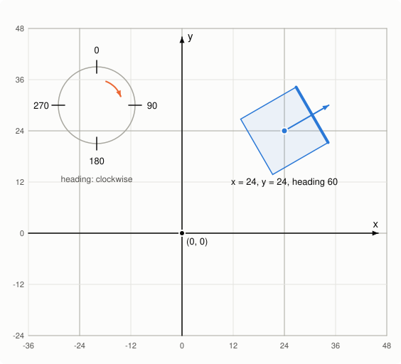
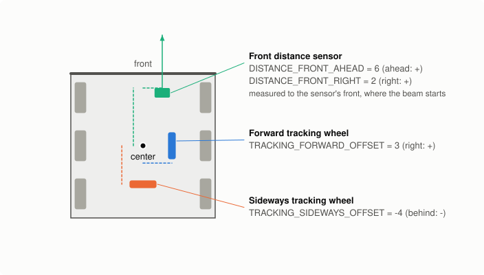
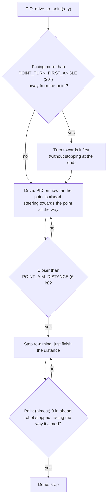
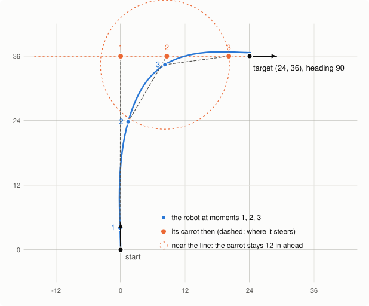
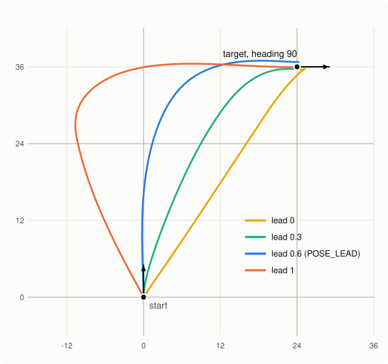
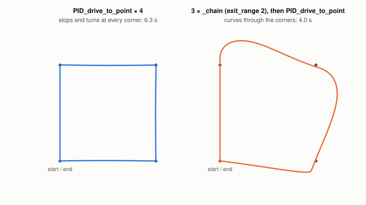
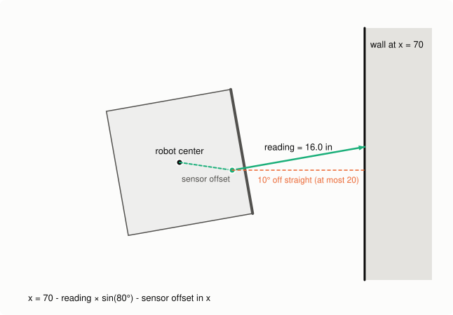
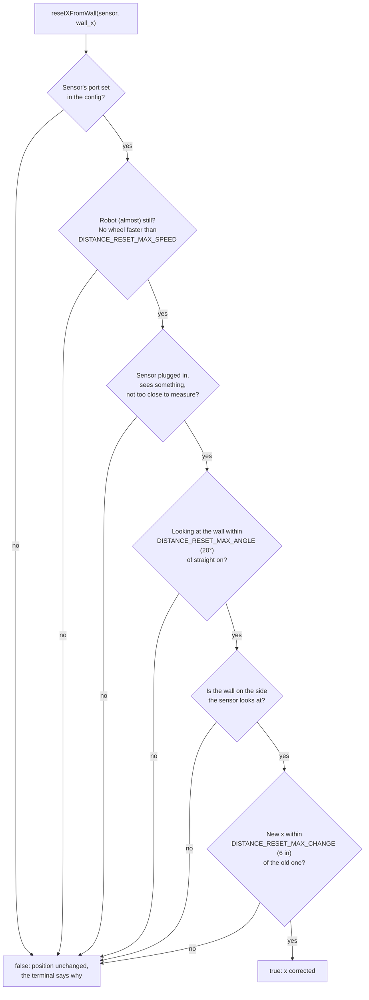

# Odometry and paths: driving on the field

This page is about using the field-position features: telling the robot where it is, driving to
points and poses, chaining them into paths, and correcting the position from a wall. How the math
works inside is in [how-it-works §7 and §8](how-it-works.md#7-odometry-where-is-the-robot); this
page is about what to call and what to expect.

The paths in the pictures come from the library's own code, driving the simulator in
`tests/sim/vex.h` (see [Making the pictures](#making-the-pictures)). They show how the code
behaves, but they were **not driven on a real robot**: a real one slips and gets bumped, and its
paths will be a little different.

- [1. Where is the robot?](#1-where-is-the-robot)
- [2. Telling the library about your robot](#2-telling-the-library-about-your-robot)
- [3. Driving to a point](#3-driving-to-a-point)
- [4. Arriving at a heading: driving to a pose](#4-arriving-at-a-heading-driving-to-a-pose)
- [5. Paths: chaining points](#5-paths-chaining-points)
- [6. Keeping the position right: walls](#6-keeping-the-position-right-walls)
- [7. When something goes wrong](#7-when-something-goes-wrong)

## 1. Where is the robot?



The robot's position is three numbers:

- **x**: inches to the right of (0, 0),
- **y**: inches forward from (0, 0), where "forward" is the way heading 0 points,
- **heading**: degrees, **clockwise** from heading 0, from the inertial sensor.

Where (0, 0) is and which way heading 0 points is up to you: they are wherever the robot was when
you said so. `calibrateInertial()` sets the robot to (0, 0) facing 0, and `setPose` puts it anywhere:

```cpp
calibrateInertial();   // keep the robot still for about 2 seconds; now it is at (0, 0), facing 0
setPose(-48, -60, 90); // or: "the robot is at (-48, -60), facing 90"
getX(); getY();        // where the robot is now, in inches
getInertial();         // which way it faces, in degrees
```

Two common choices:

- **The robot's starting spot** is (0, 0), facing 0. Easy to measure from: "the goal is 24 inches
  to the right and 48 ahead" is `(24, 48)`.
- **The middle of the field** is (0, 0). Then the walls are at about x = ±70 and y = ±70
  (a field is 12 feet = 144 inches minus the wall thickness), the same numbers in every routine,
  and the wall corrections in [section 6](#6-keeping-the-position-right-walls) are easy to write.
  Call `setPose` with the starting spot measured from the middle.

Heading keeps counting past 360: after two turns all the way around, `getInertial()` says 720.
`PID_drive_to_point` and `PID_turn_to_point` don't care (they work out the shorter way themselves).

## 2. Telling the library about your robot

Odometry works with nothing extra: it counts the drive motors' turns for the distance and asks the
inertial sensor for the heading. Measure `WHEEL_DIAMETER_INCH` with `examples/robotSetup`
([how](first-robot-checklist.md)), or every distance comes out a little wrong.

Wheels that push the robot also slip, and odometry counts a slipping wheel as driving. Tracking
wheels fix that: small unpowered wheels with a Rotation Sensor that only roll when the robot really
moves. A **forward** one rolls when the robot drives forward; a **sideways** one rolls when the robot is
pushed sideways (by another robot, or skidding through a turn). Each is optional.



Everything on the robot is measured from its **center**: the point halfway between the left and
right drive wheels, which is the point the robot turns around. In `simpleV5LibConfig.h`:

| What | Constant | Measured |
|---|---|---|
| Forward tracking wheel | `TRACKING_FORWARD_PORT`, `TRACKING_FORWARD_OFFSET` | inches to the right of the center (left = negative) |
| Sideways tracking wheel | `TRACKING_SIDEWAYS_PORT`, `TRACKING_SIDEWAYS_OFFSET` | inches in front of the center (behind = negative) |
| Distance sensors (front, back, left, right) | `DISTANCE_FRONT_PORT`, `DISTANCE_FRONT_AHEAD`, `DISTANCE_FRONT_RIGHT`, ... | where the front of the sensor is: ahead (+) / behind (-), right (+) / left (-) |

A port of -1 means "not there". `measureTrackWidth()` also measures the tracking wheels' offsets
(after `measureWheelSize()`), so you don't need to measure them with a ruler. Distance sensors
you measure yourself.

## 3. Driving to a point

```cpp
PID_drive_to_point(24, 48, 0.5, 0.2);   // drive to (24, 48); stop within 0.5 in, slower than 0.2 in/s
PID_drive_to_point(0, 0, 0.5, 0.2, FORWARD_TIMEOUT_MS, 100, true);   // back up to (0, 0)
PID_turn_to_point(0, 48, 0.5, 0.2);     // only turn, to face (0, 48)
```

What the robot does:



Three things worth knowing:

- **"Ahead", not "how far away".** The PID drives until the point is 0 inches *in front* of the robot.
  The robot can't drive sideways, so a point an inch beside it counts as reached. That's why it
  stops re-aiming in the last 6 inches: there, a small sideways miss would swing the aim around a lot.
- **It keeps aiming.** If the robot gets bumped, or one side is weaker, it steers back towards the
  point. The harder it steers, the slower it drives (so the wheels don't skid).
- **Timeouts.** If the robot is blocked, it gives up after `FORWARD_TIMEOUT_MS` (or the timeout
  you pass) so the rest of the routine still runs. `lastMovementResult().timed_out` tells you.

## 4. Arriving at a heading: driving to a pose

`PID_drive_to_pose(x, y, heading)` drives to the point *and* arrives facing `heading`, in one curve
instead of drive-then-turn. A pose is a point plus a heading.

```cpp
PID_drive_to_pose(24, 36, 90, 0.5, 0.2);   // curve to (24, 36), arriving facing 90 (to the right)
PID_drive_to_pose(24, 36, 90, 0.5, 0.2, FORWARD_TIMEOUT_MS, 100, false, 0.3);   // lead 0.3: a flatter curve
```



The robot doesn't steer at the target itself. It steers at a **carrot**: a point on the line it must
arrive along (dotted orange), `lead` × (the distance still to go) behind the target. Far away
(moment 1) the carrot is far back, so the robot heads for the line instead of the target. As it gets
closer (2) the carrot slides towards the target. Near the line (3) the carrot stays 12 inches
(2 × `POINT_AIM_DISTANCE`) ahead of the robot, so the robot settles onto the line and drives along it.
In the last 12 inches the robot steers more and more by the target heading itself.



`lead` (from 0 to 1, default `POSE_LEAD` = 0.6) sets the shape:

- **Bigger** = a wider curve that lines up with the heading earlier. Lead 1 swings far out to the side
  first, so it needs room on the field.
- **Smaller** = a straighter drive that turns harder at the end. Lead 0 drives straight at the point
  and turns to the heading on the way in.

All four end at the target facing 90 (in the simulator: within 1 inch and 2 degrees).

When *not* to use it:

- **The pose points back at the robot** (like `(0, 24, 180)` from `(0, 0, 0)`): there is nothing to
  curve into. The robot drives there and turns around on the spot, which `PID_drive_to_point` and
  `PID_turn` do just as well.
- **The pose is close and well to the side** (like `(10, 10, 0)`, about a foot away and 10 inches
  beside its line): there is no room to curve, and the robot ends 2 to 6 inches beside the target.
  Use `PID_drive_to_point` and a turn.

## 5. Paths: chaining points

A normal movement stops at its target. A **chained** one hands over to the next movement a little
before the target and doesn't stop, so a list of points becomes one smooth path:

```cpp
PID_drive_to_point_chain(0, 24, 2);    // move on 2 inches before (0, 24)
PID_drive_to_point_chain(24, 24, 2);   // curves towards the next point without stopping
PID_drive_to_point_chain(24, 0, 2);
PID_drive_to_point(0, 0, 0.5, 0.2);    // the last one is normal: it stops exactly at (0, 0)
```



The chain is about a third faster. The price is that the path is round: the robot drives through
each corner point (within half an inch, in the simulator) but can't turn sharply at speed, so after a
sharp corner it swings out and comes back. Mind that next to walls and game objects.

**Choosing `exit_range`** (the third number): the bigger it is, the earlier the robot moves on, and
the faster it is still going when it does. Measured in the simulator on a path of three points with
one corner in the middle (the time is for the whole path; "swings out" is how far the robot gets
from the straight line after the corner):

| exit_range | gentle corner (23°): (0, 24) → (10, 48) → (20, 72) | sharp corner (90°): (0, 24) → (24, 24) → (48, 24) |
|---|---|---|
| normal movements (stop at every point) | 4.1 s | 4.3 s |
| 2 | 2.4 s, swings out 1.5 in | 2.5 s, swings out 6 in |
| 4 | 2.1 s, swings out 1.4 in | 3.2 s, swings out 9 in |
| 8 | 2.1 s, swings out 0.7 in | 3.5 s, swings out 18 in |

So: **gentle corners like a big exit_range (4 to 8), sharp corners a small one (about 2)**. A sharp
corner can't be taken at speed anyway, so moving on earlier only makes the robot swing wider, and
coming back from that takes longer.

More rules of a chain:

- **End with a normal movement**, so the robot stops in the right place. If nothing follows a chained
  movement within `CHAIN_STOP_AFTER_MS`, the drivetrain stops on its own.
- **A corner of more than 120°** (the next point is almost behind the robot) is not curved through:
  the robot turns towards it first.
- **Poses chain too**: `PID_drive_to_pose_chain(x, y, heading, exit_range)` curves in along the heading
  and hands over still rolling, so a path can line up with something before driving on.
- **Doing things on the way**: the `_async` versions return right away, and `waitUntilTraveled(inches)`
  waits for a spot on the way (see the README's "Do something while driving").

## 6. Keeping the position right: walls

Odometry adds up thousands of tiny movements, so tiny mistakes (a wheel slipping, a push the wheels
didn't notice) add up too. Over a long routine the position slowly drifts. The field walls don't
move, so they can fix it.

**Without a sensor**: drive gently into a wall and tell the robot where it is. Only that one number
changes; the other one and the heading stay.

```cpp
PID_forward(-6, 0.5, 0.2, 1000, 30);   // back gently into the wall at y = -70 (it times out against it)
setY(-70 + 7);                         // the wall is at y = -70, the robot's center 7 inches from its back
```

**With a distance sensor** (it doesn't need to touch the wall): stop, face a wall, and let the sensor
measure. `resetXFromWall` is for a wall at x = something, `resetYFromWall` for a wall at y = something.

```cpp
PID_turn_shortest(90, 0.5, 0.2);   // face the right wall, x = 70
wait(100, msec);                   // stop completely first
resetXFromWall(FRONT_SENSOR, 70);  // x from the front sensor's reading
```



The library works back from the wall: along the sensor's beam to the sensor, then from the sensor to
the robot's center. The sensor doesn't have to look at the wall exactly straight on: the reading is
corrected for the angle. A bad reading would be worse than none, so the reset checks it first, and if
something is wrong it leaves the position alone, returns `false`, and prints why in the terminal:



The last check catches the sensor seeing another robot or a game object instead of the wall: odometry
is rarely 6 inches off, so a reading that says it is, is more likely wrong. After a big crash, when it
really can be, allow more for that one reset: `resetXFromWall(FRONT_SENSOR, 70, 12)`.

Tips:

- **Reset close to the wall.** The sensor is most exact up close (about ±15 mm under 20 cm, about 5%
  further away). Pressed right against it (under about 20 mm) it can't measure: use `setX`/`setY` then.
- **Reset where nothing is in the way**, so the beam hits the wall and not a game object.
- **Reset often in a long routine**: before a movement that needs to be exact, not only at the start.
- **Check the result** if the routine depends on it: `if (!resetXFromWall(...)) { ... }`.

## 7. When something goes wrong

| What you see | Most likely | What to do |
|---|---|---|
| Every distance is a little short or long (24 in drives 23) | `WHEEL_DIAMETER_INCH` or the gear ratio | Run `measureWheelSize` ([checklist](first-robot-checklist.md)) |
| x and y drift during turns in place (with tracking wheels) | A tracking wheel offset | Run `measureTrackWidth` after `measureWheelSize`: it measures the offsets too |
| x and y count the wrong way (driving forward makes y go down) | A reversed tracking wheel | Flip `TRACKING_..._REVERSED`; push the robot by hand and watch `getX()`/`getY()` |
| The robot turns the wrong way to a point | Field picture mixed up, or the gyro sign | x is to the *right*, heading clockwise: check with `examples/odometry`. Then `testDrivetrain()` |
| Drifts a few inches over a routine, worse after pushing | Slipping drive wheels | Tracking wheels, and wall resets |
| A drive to a pose ends inches beside the target | A short pose well to the side ([section 4](#4-arriving-at-a-heading-driving-to-a-pose)) | `PID_drive_to_point` and a turn |
| A chain swings wide past a corner | `exit_range` too big for a sharp corner | Smaller `exit_range` there ([section 5](#5-paths-chaining-points)) |
| `resetXFromWall` returns false | One of the checks in [section 6](#6-keeping-the-position-right-walls) | Read the terminal: it says which |

## Making the pictures

The pictures in `docs/images` are drawn by `docs/diagrams/diagrams.cpp`, which runs the library on the
simulator and records where the simulated robot went. After changing how the robot drives, run
`docs/diagrams/make_diagrams.sh` (it needs the same C++17 compiler as `tests/run_tests.sh`) and look
at the pictures again.
