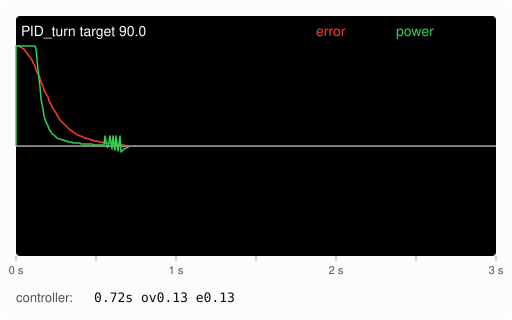
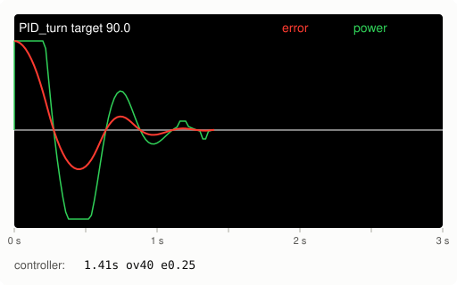
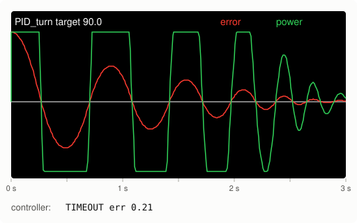
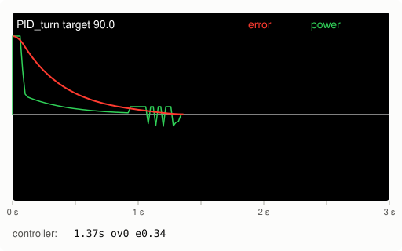
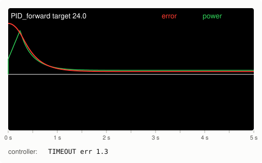
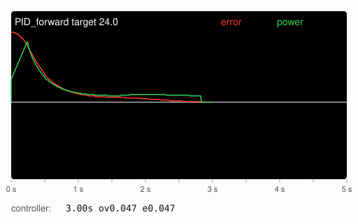
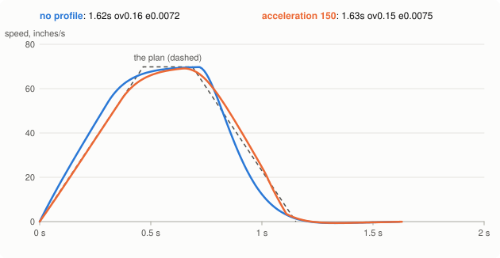

# Tuning the PID: reading the graph

Every movement in this library is driven by a PID controller with three numbers, the **gains**:
kP, kI and kD ([How it works, section 1](how-it-works.md#1-pid-the-heart-of-every-movement)
explains what each one does). The gains in `simpleV5LibConfig.h` are only a starting point: the
turn gains were tuned on the simulator, `FORWARD_KD` has to be tuned again
([section 7](#7-try-other-sizes-then-the-other-movements)), and the swing and arc gains are copies
of the turn and forward gains that nobody has tuned yet. And your robot is heavier or lighter, its
motors and wheels are different, and its wheels rub differently on the tiles, so it needs its own
gains anyway. This page shows how to find them: what the Brain screen shows during a movement, what
each kind of mistake looks like, and which gain to change.

The pictures below are what the Brain screen shows with `graphOnScreen(true)`: every line the
library drew on the simulator's screen, in the same place and color
([Making the pictures](#making-the-pictures)). A real robot's lines are a bit rougher, but have the
same shapes.

- [1. Before you start](#1-before-you-start)
- [2. The tuner on the controller](#2-the-tuner-on-the-controller)
- [3. Reading the graph](#3-reading-the-graph)
- [4. kP: get there, and a bit too far](#4-kp-get-there-and-a-bit-too-far)
- [5. kD: stop the swinging](#5-kd-stop-the-swinging)
- [6. kI: only if it stops short](#6-ki-only-if-it-stops-short)
- [7. Try other sizes, then the other movements](#7-try-other-sizes-then-the-other-movements)
- [8. Keeping the gains](#8-keeping-the-gains)
- [9. Looking closer: the numbers behind the graph](#9-looking-closer-the-numbers-behind-the-graph)
- [10. Other settings that change how a movement ends](#10-other-settings-that-change-how-a-movement-ends)
- [11. What you see, what to change](#11-what-you-see-what-to-change)
- [12. Optional: a speed profile](#12-optional-a-speed-profile)

---

## 1. Before you start

- **Set up the robot first.** A motor turning the wrong way, or a gyro rate with the wrong sign,
  can't be tuned away: the robot fights itself, and no gain fixes that. Run `examples/robotSetup`
  first, and put the measured wheel size and track width into the config. On a new robot,
  [First day on a real robot](first-robot-checklist.md) has every step in order; tuning is
  steps 5 to 7 there.
- **Room to move.** The tuner turns 90° and drives 24 inches, then back again. Give the robot a
  clear tile or two.
- **A charged battery.** A robot with a nearly empty battery is slower, and gains tuned on it
  overshoot on a full one.
- **Tune in this order:** turns, then driving forward, then swings, then arcs. Turns are the
  easiest to watch. The swing and arc gains start as copies of the turn and forward gains.

## 2. The tuner on the controller

`examples/tuning` calls `tuneWithController()`, which lets you change the gains from the
controller and try them right away, without downloading the program again:

| Button | What it does |
| --- | --- |
| X | Pick what to tune: TURN, FORWARD, SWING or ARC |
| Up / Down | Pick kP, kI or kD |
| Right / Left | Make it about 10% bigger / smaller. Hold it to keep changing: 5 steps a second, so from 1 to 10 takes about 5 seconds |
| A | Try it: turn 90°, drive 24 inches, swing 90° or drive a 90° arc. The next A goes back |
| B | Done: save the gains on the SD card and show them on the Brain screen ([section 8](#8-keeping-the-gains)) |

After each try the controller shows how it went, for example `0.72s ov0.13 e0.13`:

- `0.72s`: the movement took 0.72 seconds to finish.
- `ov0.13`: the **overshoot**, how far it went past the target at most (degrees for turns,
  inches for driving). `ov0` means it never went past.
- `e0.13`: the **error** at the end, how far from the target it stopped.
- `TIMEOUT err 1.3` instead means it didn't finish before its time limit (3 seconds for a turn,
  5 for driving), and ended 1.3 from the target.

Those three numbers are what you tune for: a short time, a small overshoot, a small error. The
graph shows *why* a number is bad.

## 3. Reading the graph



This is a good 90° turn (the config's kP 3.2 and kD 36.7, no kI):

- The **white line** is 0: the robot is at the target.
- The **red line is the error**, how far the robot still has to go. It starts at the top (the
  whole 90°) and comes down to the white line. Above the white line the target is still ahead;
  below it, the robot has gone past.
- The **green line is the power** the PID asks for, 100% at the top, -100% (full power the other
  way) at the bottom.
- From left to right is time. The whole time limit fits across the screen: 3 seconds for a turn,
  5 for driving. A good movement uses only the left part.

Here the red line slides down onto the white line without crossing it, and the green line drops
from full power to almost nothing as the robot gets close. The jagged bit at the end of the green
line isn't the PID: the robot had almost stopped just short of the target, so the library gave it
small pushes (`TURN_MIN_SPEED`, more in [section 5](#5-kd-stop-the-swinging)). They carry it the
last bit, and a hair past the target (`ov0.13`).

The graph's height is the whole movement, so a small leftover error (an inch out of 24) is only a
few pixels above the white line. For small numbers, read `e` on the controller.

## 4. kP: get there, and a bit too far

Start with **kI and kD at 0**, so only kP pushes. Then raise kP until the robot gets to the target
quickly, goes past it, and swings back and forth a few times before it stops:



That's what kP alone looks like at a good value (3.2, the config's kP). The red line crosses the
white line: the robot went 40° past the target (`ov40`), came back, went past a little again, and
then stopped. The green line shows why: the power only turns around once the robot is already past
the target. P pushes harder the further away the robot is, and nothing in it brakes.

If the robot doesn't go past at all, kP is too small: raise it. If it swings like this, kP is too big:



With kP 10 the power slams from full forward to full backward, and the robot is still swinging
when the time runs out (`TIMEOUT`). Lower kP until it swings only a few times, like the picture before.

## 5. kD: stop the swinging

Now raise **kD** until the overshoot (`ov`) is close to 0. The D part brakes: it pushes against
the way the robot is moving, harder the faster it moves. With kD 36.7 you get the good turn from
[section 3](#3-reading-the-graph). In between, the overshoot shrinks quickly as kD goes up, and
then the turn gets slower again:

| kD (kP 3.2, no kI) | Time | Overshoot |
| --- | --- | --- |
| 0 | 1.41 s | 39.7° |
| 10 | 0.90 s | 17.8° |
| 20 | 0.55 s | 1.5° |
| 36.7 (the config) | 0.72 s | 0.1° |
| 60 | 0.97 s | 0 |
| 100 | 1.37 s | 0 |

(PID_turn(90) on the simulator. Your robot's numbers will be different; the pattern is the same.)

So more kD isn't always better. Pick the smallest kD that gives an overshoot you are happy with:
here 20 is the fastest, and 36.7 gives up a sixth of a second to stop almost exactly on target.
This is what too much kD looks like:



The brake is so strong that the robot creeps the last part of the turn: the red line bends over
slowly. When it has almost stopped, short of the target, the library gives it a small push
(`TURN_MIN_SPEED`, 10%). That is the jagged part of the green line at the end: each push gets the
robot moving, the D part brakes it again, and the next push follows. With this much kD that goes on
for about 0.4 seconds.

On a real robot, too much kD has a second sign: the robot **shakes or buzzes**, and the green line
jumps up and down quickly. The speed readings are a little noisy, and kD multiplies the noise
along with the speed. The simulator's readings are perfect, so the pictures can't show this. Lower kD.

## 6. kI: only if it stops short

Friction can stop a robot just short of the target. Near the target the error is small, so P
asks for very little power, and that little power isn't enough to move the robot. The simulator
normally has no friction at all, so for these two pictures it was given wheels that need 8% power
before they move. Here a forward drive with kP 6 and no kI:



Look closely: after 1.5 seconds the red line runs flat, just above the white line. The robot
stopped 1.3 inches short, and the green line stays at about 8%: P = 6 × 1.33 inches = 8%, exactly
what the friction takes. The robot never gets within the 0.3 inch tolerance, so the movement waits
until its time runs out (`TIMEOUT err 1.3`).

The I part fixes that. It adds up the error while the robot is close, so a small error that
doesn't go away slowly builds up a push. The same drive with kI 0.1:



Now the green line slowly climbs while the robot sits short of the target, until the push is
strong enough to move it. It gets there after 3 seconds, and ends 0.05 inches past the target
(`3.00s ov0.047 e0.047`).

Raise kI in small steps, and stop as soon as the robot gets there. Too much kI makes it go past
the target, because the push built up while standing still is still there when the robot
starts moving:

| PID_forward(24), kP 6, friction 8% | Time | Overshoot | Ends |
| --- | --- | --- | --- |
| kI 0 | 5.01 s, timed out | 0 | 1.33 in short |
| kI 0.05 | 3.87 s | 0 | 0.12 in short |
| kI 0.1 | 3.00 s | 0.05 in | 0.05 in past |
| kI 0.2 | 2.59 s | 0.2 in | 0.21 in past |

Two things to know:

- **The I part only adds up inside the integral range** (`FORWARD_INTEGRAL_RANGE`, 1.5 inches;
  `TURN_INTEGRAL_RANGE`, 10°), so it can't build up a huge push on the way there. If the robot
  stops *further* away than that, kI does nothing at all. With kP 4 instead of 6, the robot above
  stops 2 inches short, outside the 1.5 inches, and every kI from 0 to 0.2 still times out with
  the robot 2 inches short. Raise kP first, or make the integral range a little bigger than
  where the robot stops.
- **Turns have a second way to get there**: when a turn has almost stopped short of the target,
  the library gives it at least `TURN_MIN_SPEED` (10%) power. So turns often need no kI at all;
  if one still stops short, raise `TURN_MIN_SPEED` a little first.

## 7. Try other sizes, then the other movements

The tuner only tries 90° turns and 24 inch drives. Gains that are good for those can overshoot on
a bigger movement, where the robot gets faster and has more to brake. Once the gains are in the
config, try a small and a big movement in your own code. On the simulator the config's gains
(including kI) do this:

| Movement | Time | Overshoot | Ends |
| --- | --- | --- | --- |
| `PID_turn(30)` | 0.51 s | 0.9° | 0.17° off |
| `PID_turn(90)` | 0.71 s | 0.9° | 0.20° off |
| `PID_turn(180)` | 0.87 s | 0.9° | 0.19° off |
| `PID_forward(6)` | 0.66 s | 0.07 in | 0.07 in off |
| `PID_forward(24)` | 1.28 s | 0.15 in | 0.01 in off |
| `PID_forward(48)` | 1.62 s | 0.16 in | 0.01 in off |

Then press X and do the same steps for the others:

- **FORWARD** drives 24 inches, and back. The numbers are on a different scale from the turn's
  (the config has kD 36.7 for turns and 0.78 for driving), because the error is in inches, not
  degrees. Don't copy gains from one to the other. On a real robot, tune `FORWARD_KD` again from
  0: the config's 0.78 dates from a bug where the D part pushed instead of braking.
- **SWING** swings 90° on the left side. It starts with the turn gains, but only one side pushes,
  so swings often need a bigger kP.
- **ARC** drives a 90° arc along a 24 inch circle. It starts with the forward gains, and needs the
  right `TRACK_WIDTH_INCH` first.

Driving to a point and to a pose use the forward gains for the distance, plus their own steering
settings ([section 10](#10-other-settings-that-change-how-a-movement-ends)).

## 8. Keeping the gains

The gains you change with the controller only live in the robot's memory: they are gone when the
program stops. Two ways to keep them:

- **With an SD card in the Brain**, B saves all four sets in `pid_gains.txt`.
  `loadGainsFromSDCard()` at the start of a program loads them again (`examples/tuning` does, so
  the next tuning session carries on where the last one stopped).
- **Always, in the end:** B also shows the gains on the Brain screen and prints them in the
  terminal, as lines to copy into `simpleV5LibConfig.h`. Do that once you're happy, so the
  robot drives the same without the card.

Each line in `pid_gains.txt` remembers what the config said when it was saved
(`TURN_KP = 3.5 config 3.2`). If you change `TURN_KP` in the config later, the config wins and the
old value on the card is ignored, so an old file can't quietly undo an edit you made by hand
([How it works, section 9](how-it-works.md#what-the-gains-file-remembers)).

## 9. Looking closer: the numbers behind the graph

The graph shows only the error and the total power. For more, turn on the logs (both are on in
`examples/tuning`):

- **`logToTerminal(true)`** prints every movement in the terminal (connect a USB cable and open
  the terminal in VEXcode):

  ```
  # PID_turn target=90.00
  time_ms,error,speed,output,p,i,d
  0,90.000,0.000,100.0,288.0,0.0,-0.0
  20,89.459,0.511,100.0,286.3,0.0,-18.8
  40,87.895,1.023,100.0,281.3,0.0,-37.5
  ...
  ```

  `output` is the green line. (At the start P asks for far more than 100%; the power is capped at 100.) `p`, `i` and `d` are the three parts it was added up from: they show
  which part pushes when. In [section 6](#6-ki-only-if-it-stops-short) for example, `i` is what
  slowly grows while the robot stands short of the target. To make a chart, copy the lines from
  `time_ms,...` down into a spreadsheet (one value per column) and insert a line chart.
- **`logToSDCard(true)`** writes the same numbers, plus where the robot was (x, y, heading), into
  `pidlog1.csv`, `pidlog2.csv`, ... on the SD card, a new file every program run. It works without
  a cable, so it can record a whole match. In a spreadsheet, filter the `move` column to one
  movement and chart `error` and `output` against `time_ms`.

## 10. Other settings that change how a movement ends

The gains decide how the robot drives to the target. These settings in `simpleV5LibConfig.h`, and
the numbers you give each movement, decide when it counts as there:

| Setting | What it does | Change it when |
| --- | --- | --- |
| `error_tolerance`, `speed_tolerance` (the two numbers after where to go: 0.5 and 0.2 in `PID_turn(90, 0.5, 0.2)`, in `PID_swing` and `PID_arc` after the side or the radius) | Closer than the first, slower than the second: there. `_chain` movements have none, they hand over at `exit_range` instead | Movements wait at the end for no visible reason (too tight), or end a bit off (too loose) |
| `TURN_SETTLE_MS`, `FORWARD_SETTLE_MS` | How long it must stay inside both tolerances (50 ms) | Rarely: it stops a robot flying past from counting as there |
| `TURN_TIMEOUT_MS`, `FORWARD_TIMEOUT_MS` | The time limit: also how wide the graph is | A long movement that's fine times out anyway (or pass a timeout to that movement) |
| `TURN_INTEGRAL_RANGE`, `FORWARD_INTEGRAL_RANGE` | The I part only adds up closer than this | The robot stops short outside it ([section 6](#6-ki-only-if-it-stops-short)) |
| `TURN_MIN_SPEED` | The smallest push for a turn that stopped short | Turns stop just short and stay there |
| `FORWARD_HEADING_KP` | Keeps `PID_forward` straight: power added per degree it drifts | It drifts off a degree or two over 48 inches (raise), or weaves (lower) |
| `POINT_HEADING_KP`, `POINT_HEADING_KD` | Steering while driving to a point or a pose | It weaves on the way (less KP, or more KD), or turns too slowly onto the point (more KP) |
| `DRIVE_SLIP_LIMIT` | Traction control: how far the power can get ahead of the wheels | The wheels chirp or slide at starts and stops (lower); see the [checklist, step 8](first-robot-checklist.md#8-traction-control) |
| `DRIVE_ACCELERATION`, `DRIVE_RESPONSE_MS` | The speed profile, off (0) unless you turn it on ([section 12](#12-optional-a-speed-profile)) | With the profile on: it goes past the target (more `DRIVE_RESPONSE_MS`), stops short and creeps in (less), or the wheels slip (less `DRIVE_ACCELERATION`) |

## 11. What you see, what to change

| What you see | What to change |
| --- | --- |
| Red line crosses the white line and swings back: the robot goes past the target | More kD, or less kP ([section 5](#5-kd-stop-the-swinging)) |
| Swings back and forth until it times out | Less kP ([section 4](#4-kp-get-there-and-a-bit-too-far)) |
| Red line comes down slowly, the movement takes long | More kP; or less kD if the line bends over slowly near the end |
| Red line runs flat just above the white line, then a timeout | More kI, or a bigger integral range; for turns, more `TURN_MIN_SPEED` ([section 6](#6-ki-only-if-it-stops-short)) |
| Good after a stop, then it rolls past the target | Too much kI: lower it |
| The robot shakes or buzzes, the green line jumps up and down | Less kD |
| Turns go crazy, spinning faster and faster | Not a gain: `getGyroRate` has the wrong sign. Run `testDrivetrain()` |
| `PID_forward` ends turned a few degrees | `FORWARD_HEADING_KP` ([section 10](#10-other-settings-that-change-how-a-movement-ends)) |
| A movement goes the wrong way, or the robot fights itself | Not a gain: wiring or motor directions. Run `examples/robotSetup` |
| With the speed profile on: goes past the target, or stops short and creeps in | `DRIVE_RESPONSE_MS` first, not the gains ([section 12](#12-optional-a-speed-profile)) |

## 12. Optional: a speed profile

Everything above is about the PID alone, and that is how the library drives unless you turn the
speed profile on. With only a PID, how fast a drive speeds up and how hard it brakes comes out of
the gains: P asks for full power far from the target and less near it, D brakes, and traction
control ([How it works, section 1](how-it-works.md#not-letting-the-wheels-slip-traction-control))
keeps it from slipping. A speed profile *plans* it instead: speed up at `DRIVE_ACCELERATION`
(inches/s per second), drive at `max_speed`, slow down at `DRIVE_ACCELERATION` again so it stops at
the target. The robot gets the power for the planned speed straight away, and the PID only corrects
how far the robot is behind or ahead of the plan; at the end, the PID finishes the movement as
always. It works for `PID_forward`, `PID_drive_to_point` and `PID_drive_to_pose` (turns, swings and
arcs keep the PID alone). [How it works, section 3](how-it-works.md#planning-the-speed-a-speed-profile)
explains how.



The dashed line is the plan for `PID_forward(48)` with acceleration 150: up to full speed in under
half a second, then down again. The orange robot follows it. The blue one, the PID alone, speeds up
about as fast here, but brakes harder: as hard as traction control allows.

**Tune the PID first**, with the profile off: the gains still finish every movement. Then:

1. **Measure the robot.** `measureTopSpeed()` (step 5 of `examples/robotSetup`) drives forward
   at full power for about a second and shows `DRIVE_TOP_SPEED` (how fast full power drives) and
   `DRIVE_RESPONSE_MS` (how long the drivetrain takes to follow a new power). Put them in the
   config: the profile turns the planned speed into a power with them.
2. **Turn it on:** `DRIVE_ACCELERATION = 150` in the config, or `speedProfile.acceleration = 150;`
   in your code, for the movements after it.
3. **Try `PID_forward(24)` and `PID_forward(48)`** a few times, with the graph on.
   - Goes past the target: more `DRIVE_RESPONSE_MS` (the robot starts braking a little earlier).
   - Stops a bit short and creeps in slowly: less `DRIVE_RESPONSE_MS`.
   - The wheels chirp or slide at the start or the end: less `DRIVE_ACCELERATION`. Wheels with
     good grip can take more, but traction control (`DRIVE_SLIP_LIMIT`) still limits how hard any
     movement pushes and brakes, so far more than that changes little.

How it does on the simulator, with the numbers `measureTopSpeed()` measured there, 10 runs each
(ends: + = stopped short, - = went past):

| | Perfect simulator (69.8 in/s, 99 ms) | Realistic simulator (64.1 in/s, 118 ms) |
| --- | --- | --- |
| `PID_forward(6)`, no profile | 0.66 s, overshoot 0.07, ends -0.07 | 0.96 to 1.05 s, overshoot 0.11 to 0.12, ends 0.00 to 0.01 |
| `PID_forward(6)`, acceleration 150 | 0.72 s, overshoot 0.03, ends -0.03 | 0.80 to 0.85 s, overshoot 0.03 to 0.04, ends -0.04 to -0.03 |
| `PID_forward(24)`, no profile | 1.28 s, overshoot 0.15, ends 0.01 | 1.29 to 1.33 s, overshoot 0.26, ends 0.02 |
| `PID_forward(24)`, acceleration 150 | 1.26 s, overshoot 0.09, ends 0.00 | 1.06 to 1.17 s, overshoot 0.00 to 0.01, ends -0.01 to 0.00 |
| `PID_forward(48)`, no profile | 1.62 s, overshoot 0.16, ends 0.01 | 1.65 to 1.81 s, overshoot 0.32, ends 0.02 to 0.03 |
| `PID_forward(48)`, acceleration 150 | 1.62 s, overshoot 0.12, ends 0.00 | 1.21 to 1.25 s, overshoot 0.00, ends 0.02 to 0.03 |
| `PID_forward(72)`, no profile | 1.97 s, overshoot 0.16, ends 0.01 | 2.04 to 2.08 s, overshoot 0.32, ends 0.02 to 0.03 |
| `PID_forward(72)`, acceleration 150 | 1.95 s, overshoot 0.11, ends 0.00 | 1.76 to 1.89 s, overshoot 0.00, ends 0.00 to 0.01 |

On the perfect simulator it makes little difference: its wheels react at once and never slip, so
the PID alone already does well (the profile goes a little less past the target). The realistic
one has readings and commands that arrive 10 ms late, a drained battery and wheels that can slip:
there the PID alone goes about 0.3 inches past the target, and with the profile hardly at all,
and drives take 0.15 to 0.5 s less.

A `DRIVE_RESPONSE_MS` that isn't what `measureTopSpeed()` says (acceleration 150):

| | Perfect simulator | Realistic simulator |
| --- | --- | --- |
| `PID_forward(24)`, 30% too low (69 ms, 83 ms) | 1.30 s, overshoot 0.55, ends 0.03 | 1.26 to 1.38 s, overshoot 0.61 to 0.62, ends 0.03 to 0.04 |
| `PID_forward(48)`, 30% too low | 1.65 s, overshoot 0.63, ends 0.03 | 1.64 to 1.94 s, overshoot 0.68, ends 0.00 to 0.05 |
| `PID_forward(24)`, 30% too high (128 ms, 154 ms) | 1.20 s, overshoot 0.03, ends -0.03 | 1.25 to 1.62 s, overshoot 0.06, ends -0.06 to 0.00 |
| `PID_forward(48)`, 30% too high | 1.54 s, overshoot 0.03, ends -0.03 | 1.64 to 1.95 s, overshoot 0.05 to 0.06, ends -0.05 to 0.00 |

Too low goes past the target; too high brakes early and takes longer to creep in (on the realistic
simulator; on the perfect one a bit more than measured happened to be faster still). Either way the
PID still gets it there: the profile only changes how. `DRIVE_TOP_SPEED` matters less: 10% off
hardly changes these numbers. These are the simulator's numbers; a real robot's will differ, so
measure yours.

A chained movement's plan stops `exit_range` past its target, so the robot is still moving when
the next one takes over, and the next one's plan starts at the speed the robot has. A drive to a
point plans the distance ahead of the robot when it starts driving: after turning towards the
point first, that is all of it, but a chained point that curves around a corner starts with the
point off to the side (more than 20°), so the PID alone drives that one, as without a profile.

## Making the pictures

The graphs on this page are drawn by `docs/diagrams/diagrams.cpp`: it runs each movement on the
simulator with `graphOnScreen(true)`, and draws every line and text the library put on the
simulator's Brain screen. It also prints the numbers in this page's tables. The
simulator's wheels have no friction, except in the two pictures of [section 6](#6-ki-only-if-it-stops-short)
and their table (`sim::real::friction` in `tests/sim/vex.h`). The speed picture in
[section 12](#12-optional-a-speed-profile) is the simulated robot's true speed instead, and that
section's tables also come from the realistic simulator (`sim::realistic`). After changing how a movement
drives, run `docs/diagrams/make_diagrams.sh`, look at the pictures again, and compare the numbers
with this page.
