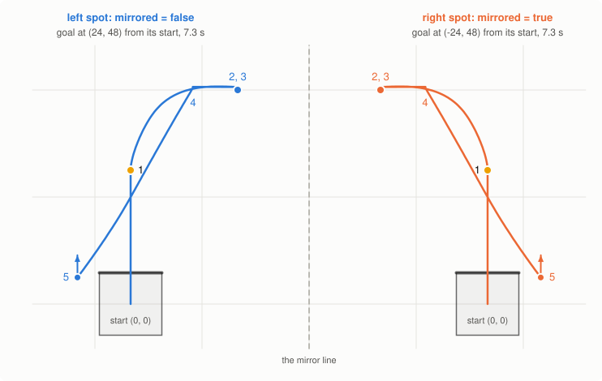

# Writing an autonomous routine

This page is about turning a plan ("drive to the game piece, score it, park") into a routine that
runs the same way every match: where the code goes, which movement to use for what, the numbers
each movement takes, doing things while driving, one routine for both starting spots, and testing.
`examples/autonomous` is the routine this page builds up to. Before this page, the robot should be
set up and tuned ([First day on a real robot](first-robot-checklist.md)): a routine can't be better
than the movements it is made of.

The picture and the times on this page come from the library driving the simulator in `tests/sim`
([Making the pictures](#making-the-pictures)). They were **not driven on a real robot**: a real one
is a little slower and less exact.

- [1. Where the code goes](#1-where-the-code-goes)
- [2. Plan it on paper first](#2-plan-it-on-paper-first)
- [3. Two ways to write the moves](#3-two-ways-to-write-the-moves)
- [4. Which movement for what](#4-which-movement-for-what)
- [5. The numbers: tolerances, timeouts, max speed](#5-the-numbers-tolerances-timeouts-max-speed)
- [6. Doing things on the way](#6-doing-things-on-the-way)
- [7. A whole routine](#7-a-whole-routine)
- [8. One routine for both starting spots](#8-one-routine-for-both-starting-spots)
- [9. Faster: chains, and the clock](#9-faster-chains-and-the-clock)
- [10. When a movement goes wrong](#10-when-a-movement-goes-wrong)
- [11. Testing a routine](#11-testing-a-routine)

---

## 1. Where the code goes

A competition program has three parts, and the field controller decides when each one runs
(`examples/competitionTemplate` and `examples/autonomous` are both built like this):

| Part | When it runs | What goes in it |
| --- | --- | --- |
| `pre_auton()` | Once, when the program starts, before the match | `calibrateInertial()` (the robot must stay still for about 2 seconds), `loadGainsFromSDCard()`, `checkDevices()`, the arm's `resetPosition`, then one `addAuton` per routine and `startAutonSelector()` |
| `autonomous()` | The autonomous period | Only `runSelectedAuton()`: it runs the routine picked on the Brain screen or with the controller's Left / Right buttons |
| `usercontrol()` | Driver control | First `stopAutonSelector()` (frees the Left / Right buttons), `cancelMovement()` (stops a movement autonomous left running) and a command for each Arm and Intake (they keep the last command autonomous gave them: `intake.stop()`), then the driving loop |

When autonomous ends, VEXcode stops the task running `autonomous()`, often in the middle of a
movement, but the library's own tasks keep running: that's why `usercontrol()` must cancel the
movement. (If your program sets `Competition.bStopAllTasksBetweenModes = true`, the library's tasks
are stopped too when the robot is disabled, and start again by themselves, except the selector's: it
stops for good if the robot is disabled while you are still choosing.
[How it works, section 5](how-it-works.md#when-the-competition-mode-changes) has the details.)

Each routine is a function of its own, `void leftSpot() { ... }`, added to the selector with
`addAuton("Left spot", leftSpot)`. The first one added is selected until someone picks another.
Two habits that save matches:

- **Never calibrate in a routine.** Calibrating takes about 2 seconds of the autonomous period, and the
  robot must not move while it does. `pre_auton` runs while the robot waits on the field.
- **Add a "Do nothing" routine** (`void doNothing() {}`). When your partner's routine needs the whole
  side of the field, the best thing your robot can do is stay out of the way.

## 2. Plan it on paper first

Draw the field, your starting spot and every place the robot has to go, and write each place down as
a field point. Measure from the robot's **starting spot**: there it is at (0, 0), facing 0, with
x to the right and y forward ([Odometry and paths, section 1](odometry-and-paths.md#1-where-is-the-robot)
has a picture, and how to use the middle of the field as (0, 0) instead). A tile is about 2 feet
(23.6 inches): measure on a field, don't just count tiles.

Every routine starts by telling the robot where it is:

```cpp
setPose(0, 0, 0); // "I'm at (0, 0), facing 0"
```

Odometry has been counting since `calibrateInertial()`: if the robot was carried or turned after
that, it would start the routine thinking it is somewhere else. `setPose` puts that right.

The routine can only be as exact as the starting spot. Put the robot in the same place every time:
pushed against the wall, or with one edge on a tile line, and write down which. An inch or two degrees
off at the start is an inch or two degrees off everywhere after.

## 3. Two ways to write the moves

The same short route, drive 30 inches, turn right and drive 24 inches, written both ways:

```cpp
// Step by step: how far, and which way to face
PID_forward(30, 0.3, 0.2);
PID_turn(90, 0.5, 0.2);
PID_forward(24, 0.3, 0.2);

// Field points: where to go
PID_drive_to_point(0, 30, 0.5, 0.2);
PID_drive_to_point(24, 30, 0.5, 0.2); // turns towards it by itself
```

**Step by step** is easier to start with: you can see each move on the field. It doesn't need
odometry. `PID_turn` turns to a heading, not by an amount, so a turn that ends a degree off doesn't
make the next turn off too. But distances add up: if a drive ends an inch short (it got bumped), every
place after it is an inch off too.

**Field points** say where to go, not how to get there. If the robot ends a drive an inch short,
the next drive to a point still goes to the right place, because it aims at the point all the way.
It needs odometry to be right: the measured wheel size and track width in the config, and over a long
routine a wall now and then ([Odometry and paths, section 6](odometry-and-paths.md#6-keeping-the-position-right-walls)).

You can mix them: odometry counts every movement, so a `PID_forward` between two points is fine,
and so is a `PID_drive_to_point` after a few step-by-step moves. A good rule: points for getting
somewhere on the field, step by step for short moves relative to where the robot is now (backing
10 inches out of a goal).

## 4. Which movement for what

| To do this | Use |
| --- | --- |
| Drive straight a distance | `PID_forward(24, 0.3, 0.2)` (negative backs up) |
| Face a heading | `PID_turn(90, 0.5, 0.2)`, or `PID_turn_shortest(90, ...)` after a lot of turning (heading keeps counting past 360: `PID_turn(0)` at heading 720 turns twice around) |
| Turn by an amount from where the robot faces now | `PID_turn_relative(-45, 0.5, 0.2)` |
| Turn while keeping one side in place (against a wall or a goal) | `PID_swing(90, LEFT_SIDE, 0.5, 0.2)`: only the left side drives |
| Drive a curve of a known size | `PID_arc(90, 24, 0.5, 0.2)`: along a 24 inch circle until facing 90 |
| Go to a place on the field | `PID_drive_to_point(24, 48, 0.5, 0.2)` |
| Face a place on the field | `PID_turn_to_point(24, 48, 0.5, 0.2)` |
| Arrive at a place, facing a heading (lined up with a goal) | `PID_drive_to_pose(24, 48, 90, 0.5, 0.2)`, one curve instead of a drive and a turn |
| Back into a place | the same, with `backwards = true` ([the README](../README.md#quick-reference) has the full lists of numbers) |
| Several places in a row, without stopping | the `_chain` versions ([section 9](#9-faster-chains-and-the-clock)) |

A pose has limits: a pose about a foot away and well beside its line has no room to curve, and ends
inches off. Then drive to the point and turn
([Odometry and paths, section 4](odometry-and-paths.md#4-arriving-at-a-heading-driving-to-a-pose)).

## 5. The numbers: tolerances, timeouts, max speed

Every normal movement takes two **tolerances** after where to go: `PID_turn(90, 0.5, 0.2)` counts as
there once the robot is within 0.5 degrees of 90 *and* turning slower than 0.2 degrees per 10 ms
(for 50 ms: `TURN_SETTLE_MS`). For drives they are inches and inches per second.

For points and poses, "within 0.5 inches" means the point is less than 0.5 inches **ahead** of the
robot. The robot can't drive sideways, so a point a little beside it counts as reached: the example
in [section 7](#7-a-whole-routine) ends its pose 0.7 to 0.8 inches beside the goal point, with a
tolerance of 0.5. A tighter tolerance doesn't make that smaller, it only makes the movement wait
longer ([Odometry and paths, section 3](odometry-and-paths.md#3-driving-to-a-point)).

- **Start with** 0.5 and 0.2 for turns, points and poses, and 0.3 and 0.2 for `PID_forward`, like the examples.
- **Looser is faster**: `PID_turn(90, 2, 1)` stops waiting sooner. Use it where a little off doesn't
  matter (a turn before a long drive to a point, which aims by itself anyway).
- **Tighter is slower**, and too tight never gets there: the movement waits until its timeout. If a
  movement always takes its full time, the tolerance is too tight for that robot, or the gains need
  work ([Tuning the PID](tuning.md)).

The **timeout** is how long a movement may take: by default `TURN_TIMEOUT_MS` (3 seconds) for turns
and swings, `FORWARD_TIMEOUT_MS` (5 seconds) for the rest. A robot stuck on a game piece or another
robot gives up then, and the routine goes on. Pass a shorter one where getting stuck is likely, so
the routine doesn't lose 5 seconds there:

```cpp
PID_forward(20, 0.3, 0.2, 1500);      // give up after 1.5 seconds
PID_forward(-8, 0.5, 0.2, 1000, 30);  // back gently into the wall: it ends by timing out against it
```

The last number, **max speed** (percent), slows a movement down: for carrying something that could
fall off, for lining up exactly, or for touching a wall gently. A slower movement needs a longer
timeout.

## 6. Doing things on the way

An `Arm` and an `Intake` run in the background: `arm.moveTo(450)` and `intake.spin(100)` return at
once, and the arm keeps moving while the robot drives ([examples/mechanisms](../examples/mechanisms/main.cpp)).
Start them before the drive, and wait for them only where the routine needs them:

```cpp
arm.moveTo(ARM_SCORE);                  // starts raising the arm...
PID_drive_to_point(24, 48, 0.5, 0.2);   // ...while the robot drives
arm.waitUntilDone();                    // up before scoring (false if it didn't make it in ARM_TIMEOUT_MS)
```

To start something partway through a drive, use the `_async` version of the movement: it starts the
drive and returns at once.

```cpp
PID_forward_async(48, 0.3, 0.2);
waitUntilTraveled(30);                  // after 30 inches...
intake.spin(100);                       // ...start the intake
waitUntilDone();                        // and wait until the drive is done
```

`waitUntilTraveled` counts from where the movement started: inches for drives, degrees for turns,
swings and arcs. The next movement always waits until the one before is done, so forgetting
`waitUntilDone()` can't start two at once.

**Every wait needs a time limit.** A loop that waits for something that never happens (the game piece
was knocked away) stops the whole routine there. The movements and `arm.waitUntilDone()` have one
built in; your own loops need one too:

```cpp
intake.spin(100, false);  // unjam off: when the piece is all the way in, the intake stops and isJammed() says so
double start = Brain.timer(msec);
while (!intake.isJammed() && Brain.timer(msec) - start < 2000) { // the piece is in, or 2 s are up
    wait(10, msec);
}
intake.stop();
```

(With the normal `intake.spin(100)`, a jam makes the intake run backwards for a moment, which would
push the piece out again, and `isJammed()` is only true during that moment.)

## 7. A whole routine

`examples/autonomous` puts it together. Its field, measured from the starting spot: a game piece
30 inches ahead, a goal at (24, 48) that the robot scores into facing 90, and a parking spot next to
the start.

```cpp
void scoringAuton() {
    double start_time = Brain.timer(msec);
    setPose(0, 0, 0); // the robot starts here, facing 0 (line it up with the tile edge)

    // 1. Drive to the game piece, intake running
    intake.spin(100);
    PID_drive_to_point(flipX(0), 30, 0.5, 0.2);

    // 2. Curve to the goal, arriving facing it, and raise the arm on the way
    arm.moveTo(ARM_SCORE);
    PID_drive_to_pose(flipX(24), 48, flipHeading(90), 0.5, 0.2);

    // 3. Score: push the game piece out, but only with the arm up. waitUntilDone() is false if the arm
    //    didn't get there in ARM_TIMEOUT_MS (blocked?): then keep the piece and go on.
    if (arm.waitUntilDone()) {
        intake.spin(-100);
        wait(400, msec);
    }
    intake.stop();

    // 4. Back away from the goal, and lower the arm while driving
    arm.moveTo(ARM_DOWN);
    PID_forward(-10, 0.3, 0.2);

    // 5. Park next to the start: one smooth path, the last point stops exactly
    PID_drive_to_point_chain(flipX(0), 24, 2);
    PID_drive_to_point(flipX(-12), 6, 0.5, 0.2);
    PID_turn_shortest(flipHeading(0), 0.5, 0.2);

    printf("Autonomous took %.1f s\n", (Brain.timer(msec) - start_time) / 1000);
}
```

`flipX` and `flipHeading` are the next section: on the left starting spot they change nothing. On
the simulator the routine takes 7.3 to 7.4 seconds, passes 0.7 to 0.8 inches from the goal point, and parks
within 0.1 inch and 0.2 degrees (10 runs). The left half of this picture is that run:



How it is put together, step by step:

- **The arm and the intake work while the robot drives** (steps 1, 2 and 4); the routine only waits
  for the arm where scoring needs it, and only scores if the arm really got up.
- **Step 2 is a pose**, so the robot arrives lined up with the goal without a turn at the end.
- **Step 4 is step by step**: "10 inches back out of the goal" is easier to say as a distance than
  as a point.
- **Step 5 chains** through (0, 24) without stopping, and the last movements are normal ones, so
  the robot stops exactly in its parking spot, facing the way it started.
- **The time is printed** in the terminal, to see how much of the autonomous period is left.

## 8. One routine for both starting spots

Most fields have a left and a right starting spot that are mirror images of each other: what is to
the right on one is to the left on the other. Instead of writing the routine twice (and fixing every
mistake twice), write it once for the left spot and flip what changes in the mirror:

```cpp
bool mirrored = false; // true = the right starting spot

double flipX(double x) { return mirrored ? -x : x; }                     // a field x
double flipHeading(double heading) { return mirrored ? -heading : heading; } // a heading, or a turn
driveSide flipSide(driveSide side) {                                      // the side of a swing
    if (!mirrored) {
        return side;
    }
    return side == LEFT_SIDE ? RIGHT_SIDE : LEFT_SIDE;
}

void leftSpot() {
    mirrored = false;
    scoringAuton();
}

void rightSpot() {
    mirrored = true;
    scoringAuton();
}
```

`leftSpot` and `rightSpot` go into the selector as two routines. The picture above is the same
`scoringAuton` from both spots: the right one (orange) is the left one turned over, and on the
simulator it ends at exactly the mirrored place.

What flips in the mirror, and what doesn't:

| In the routine | Mirrored |
| --- | --- |
| x of a point or pose | `flipX(24)` |
| y of a point or pose | stays: forward is still forward |
| A heading (`PID_turn`, `PID_turn_shortest`, a pose's heading, `PID_arc`'s target) | `flipHeading(90)` |
| A turn by an amount (`PID_turn_relative`) | `flipHeading(45)` |
| A swing | both: `PID_swing(flipHeading(90), flipSide(LEFT_SIDE), 0.5, 0.2)` |
| A distance (`PID_forward`), an arc's radius, an arm position, an intake power | stays |
| A wall reset with a side sensor | the sensor swaps sides, the wall's x flips: `resetXFromWall(mirrored ? LEFT_SENSOR : RIGHT_SENSOR, flipX(70))` |

Run every new routine from both spots before trusting the mirror: a number without its `flipX`
only shows up on the side you didn't test. The mirror only works if the field really is a mirror
image there; if the other spot has the goal somewhere else, it needs a routine of its own.

## 9. Faster: chains, and the clock

A normal movement stops at its target before the next one starts. A **chained** movement hands over a
little before it, still moving, so a list of movements becomes one smooth drive:

```cpp
PID_drive_to_point_chain(0, 24, 2);    // move on 2 inches before (0, 24)
PID_drive_to_point_chain(24, 24, 2);
PID_drive_to_point(24, 0, 0.5, 0.2);   // the last one is normal, so the robot stops in the right place
```

Driving four corners chained took about a third less time than stopping at each, on the simulator.
The price is a rounder path: the robot can't turn sharply at speed, so it swings out after a sharp
corner. Use chains where the robot has room, and normal movements where it has to be exact (scoring,
picking up). How to choose `exit_range` is in
[Odometry and paths, section 5](odometry-and-paths.md#5-paths-chaining-points): about 2 inches
before a sharp corner, about 8 before a gentle one.

**Know your time.** Print how long the routine took (like the example does), and keep a good margin
under the autonomous period: 15 seconds in a match. The example's 7.3 to 7.4 seconds are the simulator's; a
real robot is slower, and a routine that only just fits in practice won't fit after a bump. If it
doesn't fit, chain where there is room, loosen the tolerances on movements that don't need to be
exact ([section 5](#5-the-numbers-tolerances-timeouts-max-speed)), and leave out the step that
scores least.

## 10. When a movement goes wrong

Every movement ends at its timeout, so a stuck robot doesn't freeze the routine. But the rest of the
routine then starts from the wrong place. When a step matters, check how it went:

```cpp
PID_drive_to_point(24, 48, 0.5, 0.2, 2500);
if (lastMovementResult().timed_out) {
    // Didn't get there (blocked?): don't try to score, go and park instead
    PID_drive_to_point(-12, 6, 0.5, 0.2);
    return;
}
```

`lastMovementResult()` also has `error` (how far from the target it ended) and `time_ms`.

Odometry counts every bump and slip as driving, so on a long routine (skills) the position drifts
slowly. Correct it against a wall before a step that has to be exact: touch the wall and use
`setX` / `setY`, or let a distance sensor measure it with `resetXFromWall` / `resetYFromWall`
([Odometry and paths, section 6](odometry-and-paths.md#6-keeping-the-position-right-walls)).

## 11. Testing a routine

- **Test from the real starting spot**, on field tiles, with a charged battery. A routine tuned on a
  low battery overshoots on a full one.
- **Run it several times**, and mark where the robot ends with tape. A routine that ends in a
  different place every time has a problem a single run can't show.
- **Test it in steps.** While a routine is new, stop it after each step and look:

  ```cpp
  // Waits for A on the controller, and shows where the robot thinks it is
  void pause() {
      Brain.Screen.printAt(10, 200, true, "x %.1f  y %.1f  heading %.1f   ", getX(), getY(), getInertial());
      while (!Controller.ButtonA.pressing()) {
          wait(10, msec);
      }
      while (Controller.ButtonA.pressing()) {
          wait(10, msec);
      }
  }
  ```

  Put `pause();` between the steps, check each place with a tape measure, and take the pauses out
  when it works.
- **Look at what happened afterwards**: `logToSDCard(true)` in `pre_auton` saves every movement
  (target, error, position) on the SD card, and `lastMovementResult()` after a step tells you if it
  timed out ([Tuning the PID, section 9](tuning.md#9-looking-closer-the-numbers-behind-the-graph)).
- **Run it the way a match does**: with a competition switch (or the field), so `pre_auton`,
  `autonomous` and `usercontrol` run in the right order, and check that the selector shows the right
  routine and that driver control takes over cleanly.

When a routine misbehaves, [Troubleshooting](troubleshooting.md) lists the usual causes.

## Making the pictures

The picture on this page is drawn by `docs/diagrams/diagrams.cpp`, which runs `examples/autonomous`'s
own `leftSpot()` and `rightSpot()` on the simulator and records where the robot went. It also prints
the times and distances quoted here. After changing how the robot drives, or the example, run
`docs/diagrams/make_diagrams.sh`, look at the picture again, and compare the numbers with this page.
